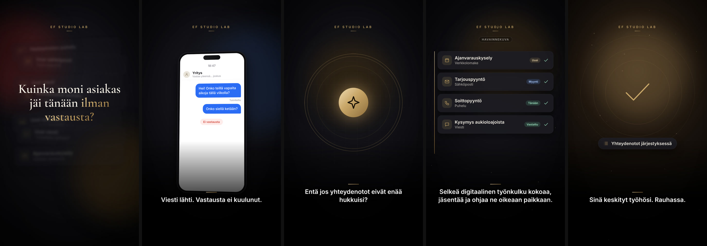

# Storyboard 1 — The Missed Customer

**Theme:** Problem → Solution  
**Visual direction:** Photorealistic, Scandinavian, cinematic. Cool winter daylight for the problem, warm gold practicals for the solution. Shallow depth of field, 35–50 mm feel, gentle handheld that settles into locked-off calm.  
**Format:** 9:16, 1080×1920, 25–27 s  
**Hook:** FI “Kuinka moni asiakas jäi tänään ilman vastausta?” · EN “How many customers went unanswered today?” · AR “كم عميلاً بقي اليوم بلا رد؟”  
**Ads built on this board:** AD01 (direct), AD09 (time theme)

*Frames above are taken from the rendered zero-credit motion-graphics cut. The live-action direction below is the full cinematic version, ready to shoot or generate when a budget is available.*

## Scene 1 · 0–4 s — Overwhelmed

- **Action:** A Finnish small-business owner (40s, apron or work shirt) stands at a light birch counter. A landline rings, a phone buzzes across the counter, a laptop shows a growing inbox. She reaches for one, then the other.
- **Camera:** Medium shot, slow handheld push-in, 35 mm. Rack focus from buzzing phone to her face.
- **Light & colour:** Soft overcast window light, desaturated blue-grey; phone screens are the only warm points.
- **Sound:** Overlapping ringtone, vibration on wood, notification pings building in rhythm. Low uneasy pad.
- **On-screen text:** Hook, centre, large serif: FI/EN/AR as above.
- **Transition out:** Whip-pan right into scene 2.
- **Zero-credit cut:** Seven notification cards drop and shake, blur back, hook rises word by word.
- **Generation prompt (image-to-video, 9:16):** `Cinematic photorealistic shot, small Finnish shop counter in soft winter daylight, a business owner in her 40s overwhelmed as a phone buzzes on the birch counter and a laptop fills with emails, slow handheld push-in, shallow depth of field, muted Scandinavian palette, phone screens blurred and unreadable, no text, no logos`

## Scene 2 · 4–8 s — The unanswered message

- **Action:** Elsewhere, a customer on a sofa sends a message from their phone, waits, checks again; the hopeful look fades and they put the phone down.
- **Camera:** Close-up on face lit by phone, 50 mm, very slow push-in; insert of thumb pressing send.
- **Light & colour:** Evening lamp light, warm key, cool window fill.
- **Sound:** Message 'sent' swoosh, room tone, a clock tick, a quiet sigh.
- **On-screen text:** Caption: “Viesti lähti. Vastausta ei kuulunut.” / “A message was sent. No reply came.” / “وصلت الرسالة. ولم يصل الرد.”
- **Transition out:** Screen light blooms to white-gold, zoom through.
- **Zero-credit cut:** Phone mock-up: sent bubble, clock racing from 14:02 to 18:47, red 'No reply' chip.
- **Generation prompt (image-to-video, 9:16):** `Cinematic photorealistic close-up, a person on a sofa in a cosy Nordic living room at evening looks at their phone waiting for a reply, hopeful expression slowly fades to mild disappointment, lowers the phone, slow push-in, warm lamp light, phone screen unreadable, no text, no logos`

## Scene 3 · 8–13 s — The turn

- **Action:** Abstract: scattered light points (calls, emails, messages) drift in dark space, then are drawn along gold lines into one calm glowing node.
- **Camera:** Virtual camera pulls back and stabilises; motion slows as order appears.
- **Light & colour:** Black to deep charcoal with gold light; first appearance of brand gold.
- **Sound:** Rising filtered whoosh resolving into a single clear chime; score lifts from minor to major.
- **On-screen text:** Caption: “Entä jos yhteydenotot eivät enää hukkuisi?” / “What if inquiries stopped slipping through?” / “ماذا لو لم تَضِع أي رسالة بعد اليوم؟”
- **Transition out:** Vertical wipe up.
- **Zero-credit cut:** Nine channel icons converge into a gold core with expanding rings.
- **Generation prompt (image-to-video, 9:16):** `Elegant abstract motion graphic, scattered small points of light on a dark charcoal background being gathered along thin gold lines into one softly glowing gold node, luxury technology aesthetic, slow graceful motion, no text, no logos`

## Scene 4 · 13–20 s — Organised

- **Action:** A clean interface lists four inquiries, each tagged and routed: new, sales, today, answered. Check marks arrive one by one.
- **Camera:** Screen-first macro, slight parallax tilt, as if looking over the owner's shoulder at a tablet.
- **Light & colour:** Warm practical light spilling on the tablet edge; gold accents.
- **Sound:** Soft ticks per row, steady optimistic pulse.
- **On-screen text:** Caption: “Selkeä digitaalinen työnkulku kokoaa, jäsentää ja ohjaa ne oikeaan paikkaan.” (+EN/AR). Small label: Havainnekuva / Concept visual.
- **Transition out:** Cross-dissolve.
- **Zero-credit cut:** Four cards slide in with tags and check marks beside a drawing gold rule.
- **Generation prompt (image-to-video, 9:16):** `Cinematic over-the-shoulder shot of a tablet on a birch desk showing a clean minimal list interface with four tidy rows and gold accents, warm lamp light, shallow depth of field, interface text abstract and unreadable, no logos`

## Scene 5 · 20–25 s — Calm

- **Action:** The owner works with a customer, unhurried; the phone lies quiet beside her. She glances at it, smiles slightly, returns to her work.
- **Camera:** Locked-off medium, 50 mm, slow dolly back.
- **Light & colour:** Golden afternoon light, warm and saturated compared with scene 1.
- **Sound:** Room tone, soft warm chord; no pings.
- **On-screen text:** Caption: “Sinä keskityt työhösi. Rauhassa.” / “You focus on your work. Calmly.” / “وأنت تركّز على عملك. بهدوء.”
- **Transition out:** Fade to black → end card.
- **Zero-credit cut:** Breathing gold rings around a drawn check mark; chip 'Inquiries in order'.
- **Generation prompt (image-to-video, 9:16):** `Cinematic photorealistic shot, the same Finnish business owner now calm and smiling while serving a customer in warm golden afternoon light, a quiet phone lying dark on the counter, slow dolly back, natural motion, no text, no logos`

## End card

Official EF Studio Lab logo (supplied file, unaltered) on black, soft gold halo and a single light sweep. Tagline: “Älykkäämpi tapa palvella asiakkaita.”. Gold CTA button. 4.6–5.0 s.

## Honesty guardrails for this board

The solution is shown as a clear digital workflow, not as a named product. No response-time, conversion or revenue figures. UI screens carry a 'concept visual' label.
