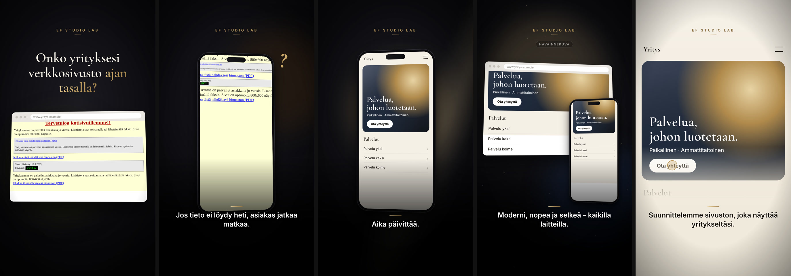

# Storyboard 2 — Business Transformation

**Theme:** Before vs. After  
**Visual direction:** Premium product commercial. Clean UI on dark seamless background, controlled reflections, smooth motion-control moves and a single signature gold scan-line transition.  
**Format:** 9:16, 1080×1920, 25–27 s  
**Hook:** FI “Onko yrityksesi verkkosivusto ajan tasalla?” · EN “Is your company's website up to date?” · AR “هل موقع شركتك مواكب للعصر؟”  
**Ads built on this board:** AD02 (direct), AD10 (showcase)

*Frames above are taken from the rendered zero-credit motion-graphics cut. The live-action direction below is the full cinematic version, ready to shoot or generate when a budget is available.*

## Scene 1 · 0–4 s — The dated site

- **Action:** An old desktop website fills a monitor: tiny serif text, visitor counter, 'last updated 2009'.
- **Camera:** Slow motion-control arc around the monitor, 85 mm, screen reflections.
- **Light & colour:** Dim office, cold monitor glow.
- **Sound:** Old PC hum, a mouse click, faint dial-up texture as a joke under the score.
- **On-screen text:** Hook in large serif above the screen.
- **Transition out:** Slide left.
- **Zero-credit cut:** Browser window with a deliberately dated page tilting in 3D; hook above.
- **Generation prompt (image-to-video, 9:16):** `Premium commercial shot, slow orbit around a slightly old monitor on a dark desk showing a dated cluttered website with small text, cold screen glow, shallow depth of field, screen content abstract, no readable text, no logos`

## Scene 2 · 4–9 s — The struggle

- **Action:** A customer on a phone pinches, zooms and pans across the same site, cannot find opening hours, gives up.
- **Camera:** Macro on hands and phone, 100 mm; then tilt up to a frustrated face.
- **Light & colour:** Daylight café window.
- **Sound:** Finger taps, a frustrated exhale.
- **On-screen text:** Caption: “Jos tieto ei löydy heti, asiakas jatkaa matkaa.” / “If customers can't find it fast, they move on.” / “إن لم يجد العميل المعلومة سريعاً، سيمضي إلى غيرك.”
- **Transition out:** Dissolve.
- **Zero-credit cut:** Phone mock-up with the old page being pinch-zoomed by two touch points; gold question mark.
- **Generation prompt (image-to-video, 9:16):** `Cinematic macro shot of hands pinching and zooming on a smartphone showing a tiny cluttered old website, the user frustrated, café daylight, shallow depth of field, screen unreadable, no logos`

## Scene 3 · 9–13 s — Transformation

- **Action:** A line of gold light sweeps down the phone; behind it the old page becomes a modern, spacious design.
- **Camera:** Locked hero angle, phone rotates a few degrees during the sweep.
- **Light & colour:** Dark seamless background; the sweep itself lights the scene.
- **Sound:** Rising shimmer, a bright chime as the sweep completes.
- **On-screen text:** Caption: “Aika päivittää.” / “Time for an upgrade.” / “حان وقت التجديد.”
- **Transition out:** Zoom through.
- **Zero-credit cut:** Gold scan-line reveal from old page to new on a phone.
- **Generation prompt (image-to-video, 9:16):** `Luxury technology commercial, a smartphone floating on a dark background as a horizontal line of gold light sweeps down its screen transforming a cluttered page into a clean modern design, smooth motion, abstract interface, no readable text, no logos`

## Scene 4 · 13–20 s — Desktop and mobile

- **Action:** Desktop browser and phone float together showing the new site; both scroll smoothly.
- **Camera:** Gentle parallax dolly, devices at slightly different depths.
- **Light & colour:** Soft gold rim light, deep blue fill.
- **Sound:** Confident mid-tempo groove.
- **On-screen text:** Caption: “Moderni, nopea ja selkeä – kaikilla laitteilla.” (+EN/AR). Concept visual label.
- **Transition out:** Wipe up.
- **Zero-credit cut:** 3D browser and phone mock-ups with scrolling concept site.
- **Generation prompt (image-to-video, 9:16):** `Premium product commercial, a laptop screen and a smartphone floating side by side on a dark background both showing the same elegant modern website with warm gold accents, gentle parallax camera move, abstract interface, no readable text, no logos`

## Scene 5 · 20–25 s — Yours

- **Action:** Close on the new site; a cursor taps the contact button.
- **Camera:** Screen-filling close-up, slow push.
- **Light & colour:** Bright, warm paper tones — the only light scene, signalling clarity.
- **Sound:** Soft click, resolving chord.
- **On-screen text:** Caption: “Suunnittelemme sivuston, joka näyttää yritykseltäsi.” / “We design a website that looks like your business.” / “نصمّم موقعاً يعكس هوية شركتك.”
- **Transition out:** Fade to black → end card.
- **Zero-credit cut:** Enlarged concept site on a paper background; cursor presses the CTA.
- **Generation prompt (image-to-video, 9:16):** `Bright clean close-up of a modern website interface on a light warm background, a cursor moving to and clicking a rounded button, premium minimal style, abstract interface, no readable text, no logos`

## End card

Official EF Studio Lab logo (supplied file, unaltered) on black, soft gold halo and a single light sweep. Tagline: “Verkkosivut, jotka tekevät vaikutuksen.”. Gold CTA button. 4.6–5.0 s.

## Honesty guardrails for this board

All websites shown are concept designs with generic names. No speed scores, ranking promises or client references. 'Fast' is used descriptively, not as a measured claim.
