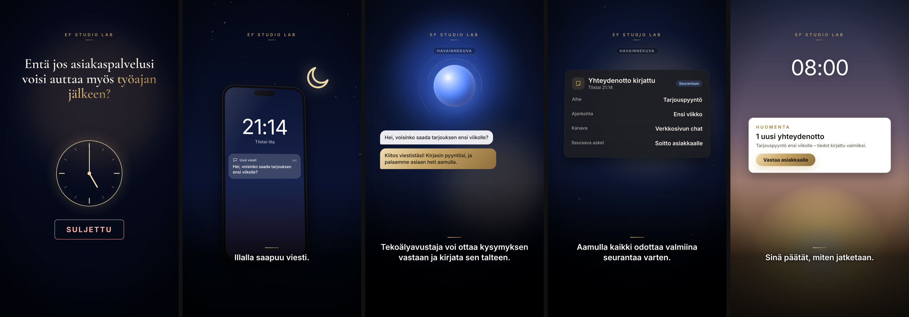

# Storyboard 3 — The AI Employee

**Theme:** Business automation  
**Visual direction:** Futuristic and sophisticated, blue-and-gold technology aesthetic. Night-to-dawn colour arc. Interfaces are elegant, minimal and clearly labelled as concepts.  
**Format:** 9:16, 1080×1920, 26–28 s  
**Hook:** FI “Entä jos asiakaspalvelusi voisi auttaa myös työajan jälkeen?” · EN “What if your customer service could help after hours, too?” · AR “ماذا لو استطاعت خدمة عملائك المساعدة بعد ساعات العمل أيضاً؟”  
**Ads built on this board:** AD03 (direct), AD05 / AD09 (automation theme)

*Frames above are taken from the rendered zero-credit motion-graphics cut. The live-action direction below is the full cinematic version, ready to shoot or generate when a budget is available.*

## Scene 1 · 0–5 s — Closing time

- **Action:** The owner switches off the lights, flips the door sign to 'Suljettu' and locks up.
- **Camera:** Wide interior, slow dolly back through the doorway; insert of the sign turning.
- **Light & colour:** Blue hour outside, warm interior lights going off one by one.
- **Sound:** Light switch, key in lock, street ambience.
- **On-screen text:** Hook in serif across the upper third.
- **Transition out:** Wipe down into night.
- **Zero-credit cut:** Gold clock sweeping to 17:00, sign flipping from Open to Closed, lights dimming.
- **Generation prompt (image-to-video, 9:16):** `Cinematic photorealistic shot at blue hour, a small Finnish business owner turns off the lights and flips the door sign to closed, warm interior fading to dark, slow dolly back, no readable signage, no logos`

## Scene 2 · 5–9 s — 21:14

- **Action:** The dark office. A phone on the desk lights up with a new message.
- **Camera:** Locked-off low angle across the desk, phone in foreground bokeh then sharp.
- **Light & colour:** Moonlight blue, the phone screen the only light source.
- **Sound:** Silence, then a single soft notification tone.
- **On-screen text:** Caption: “Illalla saapuu viesti.” / “That evening, a message arrives.” / “في المساء، تصل رسالة.”
- **Transition out:** Iris open from the screen.
- **Zero-credit cut:** Night sky with moon; lock-screen at 21:14 receiving a message notification.
- **Generation prompt (image-to-video, 9:16):** `Cinematic night shot of an empty dark office, a smartphone on a desk lights up with a notification casting blue light, moonlight through the window, shallow depth of field, screen unreadable, no logos`

## Scene 3 · 9–14 s — The assistant

- **Action:** An elegant interface: a softly pulsing orb, the customer's question, a typed acknowledgement that the request has been logged.
- **Camera:** Slow orbit around a floating glass interface.
- **Light & colour:** Deep blue volumetric light with gold ring highlights.
- **Sound:** Airy synth swell, soft keystrokes.
- **On-screen text:** Caption: “Tekoälyavustaja voi ottaa kysymyksen vastaan ja kirjata sen talteen.” (+EN/AR). Concept label.
- **Transition out:** Wipe up.
- **Zero-credit cut:** Blue orb with gold orbit rings; chat bubbles with a typed reply.
- **Generation prompt (image-to-video, 9:16):** `Sophisticated futuristic interface floating in dark blue space, a softly glowing blue orb with thin gold rings and two minimal chat bubbles, luxury technology commercial, slow orbit, abstract interface, no readable text, no logos`

## Scene 4 · 14–20 s — Ready for follow-up

- **Action:** The inquiry becomes a tidy card: topic, timing, channel, next step.
- **Camera:** Card tilts into frame in 3D, fields populate.
- **Light & colour:** Blue with warming gold from below (dawn approaching).
- **Sound:** Four soft ticks, harmony brightens.
- **On-screen text:** Caption: “Aamulla kaikki odottaa valmiina seurantaa varten.” (+EN/AR). Concept label.
- **Transition out:** Dissolve to dawn.
- **Zero-credit cut:** Dark card 'Inquiry logged' with four rows appearing.
- **Generation prompt (image-to-video, 9:16):** `Minimal dark interface card with four neat rows and a small blue tag tilting into view on a deep blue background with a hint of warm dawn light, premium UI design, abstract, no readable text, no logos`

## Scene 5 · 20–24 s — Morning

- **Action:** The owner arrives with coffee, opens the phone, sees the request and taps reply.
- **Camera:** Medium close, backlit by sunrise through the window; insert of the thumb tapping.
- **Light & colour:** Golden sunrise, long soft shadows.
- **Sound:** Birds, cup on desk, a warm bell.
- **On-screen text:** Caption: “Sinä päätät, miten jatketaan.” / “You decide what happens next.” / “وأنت تقرّر الخطوة التالية.”
- **Transition out:** Fade to black → end card.
- **Zero-credit cut:** Dawn gradient, 08:00, a light card '1 new inquiry' and a reply button being pressed.
- **Generation prompt (image-to-video, 9:16):** `Cinematic photorealistic morning shot, a Finnish business owner with a coffee cup looks at a phone and taps the screen with a calm satisfied expression, golden sunrise backlight through a window, shallow depth of field, screen unreadable, no logos`

## End card

Official EF Studio Lab logo (supplied file, unaltered) on black, soft gold halo and a single light sweep. Tagline: “Tekoälyautomaatio yrityksesi tarpeisiin.”. Gold CTA button. 4.6–5.0 s.

## Honesty guardrails for this board

The assistant is a concept: copy says it 'can' receive and log a question. It is not presented as a live, off-the-shelf product, and it never promises to answer everything or replace staff. End card: 'Solutions are designed case by case.'
