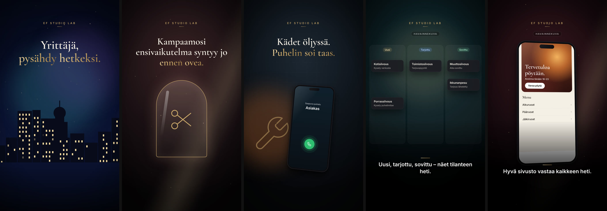

# Storyboard 4 — The Local Business Hero

**Theme:** Real Finnish businesses  
**Visual direction:** Authentic Finnish commercial photography: human-centred, warm, trustworthy. Natural light, real workplaces, hands at work. Each trade gets its own colour temperature.  
**Format:** 9:16, 1080×1920, 26–28 s  
**Hook:** FI “Suomalaisille yrityksille. Fiksumpia digiratkaisuja.” · EN “Smarter digital solutions for Finnish businesses.” · AR “حلول رقمية أذكى للشركات في فنلندا.”  
**Ads built on this board:** AD04 salon, AD05 workshop, AD06 cleaning, AD07 moving, AD08 restaurant, AD12 direct response

*Frames above are taken from the rendered zero-credit motion-graphics cut. The live-action direction below is the full cinematic version, ready to shoot or generate when a budget is available.*

## Scene 1 · 0–4 s — A Finnish city wakes

- **Action:** Establishing shot of a Finnish town at blue hour: waterfront, tram or bus, windows lighting up.
- **Camera:** Slow aerial or high tripod push-in.
- **Light & colour:** Blue hour with warm window lights.
- **Sound:** Distant gulls, tram bell, a soft opening chord.
- **On-screen text:** Optional opening line for AD12: “Yrittäjä, pysähdy hetkeksi.”
- **Transition out:** Match cut on a lit window.
- **Zero-credit cut:** Skyline silhouette with windows lighting up under a soft aurora glow.
- **Generation prompt (image-to-video, 9:16):** `Cinematic establishing shot of a Finnish city waterfront at blue hour, windows lighting up one by one, calm water reflections, slow push-in, no readable signage, no logos`

## Scene 2 · 4–9 s — The salon

- **Action:** A hairdresser finishes a cut and shows the client the mirror; her phone lies quiet on the counter.
- **Camera:** Medium two-shot through the mirror, gentle orbit.
- **Light & colour:** Warm rose-gold daylight.
- **Sound:** Scissors, soft laughter.
- **On-screen text:** AD04 lines.
- **Transition out:** Whip to workshop.
- **Zero-credit cut:** Gold arch mirror with self-drawing scissors; salon site and booking request.
- **Generation prompt (image-to-video, 9:16):** `Cinematic photorealistic shot in a bright Nordic hair salon, the hairdresser holds a hand mirror for a smiling client, warm afternoon light, gentle orbit, natural motion, no text, no logos`

## Scene 3 · 9–14 s — The workshop

- **Action:** A mechanic under a raised car; the phone rings on the tool cabinet; later he reads a tidy request on a tablet.
- **Camera:** Low angle dolly, then over-shoulder on the tablet.
- **Light & colour:** Tungsten work lights, light haze, steel blues.
- **Sound:** Ratchet, ringtone, then calm.
- **On-screen text:** AD05 lines.
- **Transition out:** Diagonal wipe.
- **Zero-credit cut:** Vibrating phone beside a line-art wrench; auto-filling service form; numbered queue with reminder.
- **Generation prompt (image-to-video, 9:16):** `Cinematic shot in a professional Finnish auto workshop, a mechanic working under a raised car pauses as a phone lights up on a red tool cabinet, tungsten work lights and light haze, slow push-in, no badges, no text, no logos`

## Scene 4 · 14–19 s — The cleaning company

- **Action:** A cleaning entrepreneur loads a van, then checks the day's appointments on a phone.
- **Camera:** Handheld follow, then close on the screen.
- **Light & colour:** Crisp morning light, fresh teal tones.
- **Sound:** Van door, footsteps, light pulse.
- **On-screen text:** AD06 lines.
- **Transition out:** Dissolve.
- **Zero-credit cut:** Sticky notes, scattered sources, cards flying into one board, three-column lead view.
- **Generation prompt (image-to-video, 9:16):** `Cinematic photorealistic shot, a cleaning company owner in a clean uniform beside a white van checks a smartphone in crisp morning light, fresh teal and white palette, handheld follow, no readable text, no logos`

## Scene 5 · 19–24 s — Helped

- **Action:** Montage of the three owners back at work, relaxed. (Variants: restaurant host for AD08, movers for AD07.)
- **Camera:** Three quick locked-off portraits, subtle push.
- **Light & colour:** Warm, unified grade.
- **Sound:** Resolving warm chord.
- **On-screen text:** “Suomalaisille yrityksille. Fiksumpia digiratkaisuja.” (+EN/AR)
- **Transition out:** Fade to black → end card.
- **Zero-credit cut:** Trade-specific closing statement or calm notification scene.
- **Generation prompt (image-to-video, 9:16):** `Three short warm documentary-style portraits of Finnish small-business owners at work, a hairdresser, a mechanic and a cleaner, each glancing up with a relaxed smile, unified warm grade, shallow depth of field, no text, no logos`

## End card

Official EF Studio Lab logo (supplied file, unaltered) on black, soft gold halo and a single light sweep. Tagline: “Suomalaisille yrityksille. Fiksumpia digiratkaisuja.”. Gold CTA button. 4.6–5.0 s.

## Honesty guardrails for this board

Businesses shown are illustrative, never presented as EF Studio Lab customers. No testimonials, names or results. Trade-specific screens are concept visuals.
