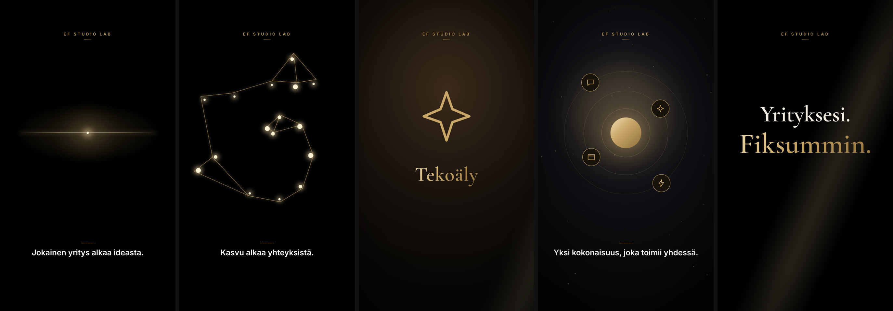

# Storyboard 5 — The Premium Brand Film

**Theme:** Technology meets business growth  
**Visual direction:** Luxury technology commercial. Black, gold light, precise motion graphics, elegant serif typography, dramatic sound design with silence used as contrast.  
**Format:** 9:16, 1080×1920, 25–27 s  
**Hook:** FI “Yrityksesi. Fiksummin.” · EN “Your business. Smarter.” · AR “أعمالك. بذكاء أكبر.”  
**Ads built on this board:** AD11 (direct); end-card language for all ads

*Frames above are taken from the rendered zero-credit motion-graphics cut. The live-action direction below is the full cinematic version, ready to shoot or generate when a budget is available.*

## Scene 1 · 0–4 s — Black

- **Action:** Black screen. A single point of gold light ignites and stretches into a horizon line.
- **Camera:** Static; the light does the moving.
- **Light & colour:** Pure black, one gold source.
- **Sound:** Deep sub boom, then near silence.
- **On-screen text:** Caption: “Jokainen yritys alkaa ideasta.” / “Every business begins with an idea.” / “كل عمل يبدأ بفكرة.”
- **Transition out:** Hard cut on the beat.
- **Zero-credit cut:** Gold spark expanding into a glowing line with a soft flare.
- **Generation prompt (image-to-video, 9:16):** `Pure black frame, a single tiny point of warm gold light ignites and stretches into a thin glowing horizontal line with a soft lens flare, luxury commercial, no text, no logos`

## Scene 2 · 4–8 s — Connections

- **Action:** Gold light reveals a network: points connect line by line into a constellation.
- **Camera:** Slow push-in through the network.
- **Light & colour:** Gold on black, soft bloom.
- **Sound:** Rising shimmer, delicate ticks as lines connect.
- **On-screen text:** Caption: “Kasvu alkaa yhteyksistä.” / “Growth begins with connections.” / “والنموّ يبدأ بالتواصل.”
- **Transition out:** Hard cut.
- **Zero-credit cut:** Sixteen nodes connected by drawing gold lines, slow zoom.
- **Generation prompt (image-to-video, 9:16):** `Elegant gold light tracing thin lines between glowing points on pure black forming a constellation network, slow push-in, soft bloom, luxury technology commercial, no text, no logos`

## Scene 3 · 8–13 s — Montage

- **Action:** Four fast beats: websites, customer communication, AI assistants, automation dashboards.
- **Camera:** Hard cuts on the beat, each with a quick settle.
- **Light & colour:** Each beat a different deep tone (charcoal, blue, warm, steel) under the same gold.
- **Sound:** Four percussive hits.
- **On-screen text:** One word per beat: Verkkosivut · Asiakasviestintä · Tekoäly · Automaatio (+EN/AR).
- **Transition out:** Zoom through.
- **Zero-credit cut:** Four full-frame cuts, large gold line icon plus one word each.
- **Generation prompt (image-to-video, 9:16):** `Fast premium montage of four abstract technology visuals in gold on dark backgrounds, a website layout, chat bubbles, a glowing AI spark, an automation flow, hard cuts with subtle settle, no readable text, no logos`

## Scene 4 · 13–18 s — Ecosystem

- **Action:** The four elements orbit a single gold core in concentric rings.
- **Camera:** Slow rotation, slight tilt.
- **Light & colour:** Gold core glow, drifting dust particles.
- **Sound:** Wide, warm sustained chord.
- **On-screen text:** Caption: “Yksi kokonaisuus, joka toimii yhdessä.” / “One whole that works together.” / “منظومة واحدة تعمل بتناغم.”
- **Transition out:** Hard cut to black.
- **Zero-credit cut:** Four icon satellites orbiting a gold core on three rings.
- **Generation prompt (image-to-video, 9:16):** `Sophisticated digital ecosystem visual, four small gold-ringed icons orbiting a glowing gold sphere on concentric thin rings against charcoal black with drifting dust, slow rotation, luxury commercial, no text, no logos`

## Scene 5 · 18–22 s — The line

- **Action:** Two lines of type on black: white, then gold.
- **Camera:** Imperceptible push.
- **Light & colour:** Black with one diagonal gold light beam.
- **Sound:** Second sub boom, then air.
- **On-screen text:** “Yrityksesi. Fiksummin.” / “Your business. Smarter.” / “أعمالك. بذكاء أكبر.”
- **Transition out:** Fade → official logo reveal (end card, 5 s).
- **Zero-credit cut:** Large serif type: first line white, second line gold, resolving from blur.
- **Generation prompt (image-to-video, 9:16):** `Typography-only frame on black with a single soft diagonal beam of gold light, space for two lines of elegant serif type added in edit, no generated text, no logos`

## End card

Official EF Studio Lab logo (supplied file, unaltered) on black, soft gold halo and a single light sweep. Tagline: “Suomalaisille yrityksille. Fiksumpia digiratkaisuja.”. Gold CTA button. 4.6–5.0 s.

## Honesty guardrails for this board

A brand statement only. The four capability words (websites, customer communication, AI, automation) restate the business's stated service areas and make no feature or result claims.
