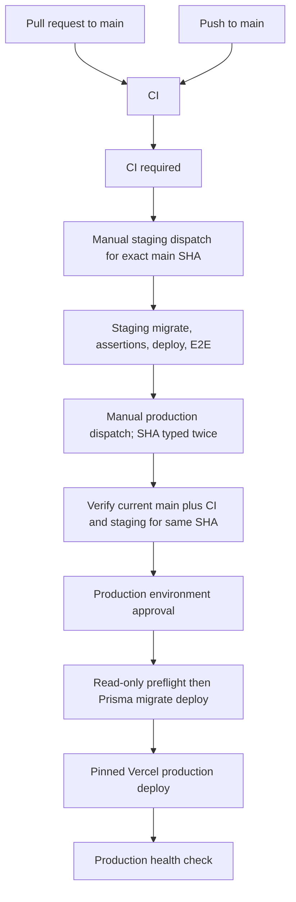

# CI and Deployment Enforcement

This document captures the manual GitHub settings that must accompany the workflow enforcement in `.github/workflows/ci.yml` and `.github/workflows/deploy.yml`.

## Branch Protection Or Ruleset

Enable a branch ruleset for `main` with these settings:

- Block direct pushes unless they pass the same pull request and status-check requirements. Prefer "Require a pull request before merging" and do not allow bypasses except repository administrators who are bound by an audited emergency process.
- Require status checks to pass before merging.
- Require branches to be up to date before merging.
- Require the workflow status check named `CI required`.
- Require conversation resolution before merging.
- Require signed commits if this is part of the organization baseline.
- Restrict who can push to matching branches to the release automation or approved maintainers only.
- Do not allow force pushes.
- Do not allow deletions.

Required status-check name:

- `CI required`

The detailed CI jobs are intentionally visible as separate checks, but branch protection should require the aggregate `CI required` check so newly split CI internals do not silently weaken protection.

## Environments

Create a `staging` environment:

- Use a separate Supabase project and a separate Vercel project containing no production data.
- Prefer reviewer approval and restrict deployment to trusted branches.
- Configure the staging-only variables and secrets listed in `docs/release-runbook.md`.
- Run `.github/workflows/staging-release.yml` manually and type the staging project ref. The workflow migrates and validates staging before deploying the application.

Create a `production` environment:

- Require reviewer approval before deployment.
- Restrict deployment branches to `main`.
- Keep environment secrets scoped to production only.
- Optional but recommended: configure wait timers or custom deployment protection rules if required by the release process.

Disable any independent Vercel, hosting-provider, or GitHub deployment path that
can deploy production directly from `main`. Production deployment is allowed
only through the manually dispatched `Production release` workflow.

## Vercel Git Preview Builds (Ignored Build Step)

Both Vercel projects are connected to this repository. `vercel.json` turns off Git
deployments for `main` only, so without an Ignored Build Step every push to any other
branch builds a Preview in each project. Those Previews count toward Functions Storage.

- **Releases don't use them.** `staging-release.yml`, `staging-deploy-only.yml` and
  `deploy.yml` upload CLI `vercel deploy --prebuilt` deployments.
- **Only `pr-preview-e2e.yml` uses one.** It needs a successful
  `Preview – syveka-ai-staging` GitHub deployment for an open PR's head SHA.

Both settings are under Project → Settings → Build and Deployment → Ignored Build Step.
They were read back on 2026-11-14:

| Project                | Behavior              | Effect                                                                 |
| ---------------------- | --------------------- | ---------------------------------------------------------------------- |
| `syveka-ai-staging`    | Custom (204 chars)    | Builds a Git Preview only when the commit message contains `[preview]` |
| `syveka-ai-production` | Only build production | Skips every Git Preview                                                |

The staging command:

```sh
[ "$VERCEL_ENV" = production ]&&exit 1;[ -n "$VERCEL_GIT_COMMIT_REF" ]||exit 1;git rev-parse -q --verify HEAD >/dev/null 2>&1||exit 1;case "$VERCEL_GIT_COMMIT_MESSAGE" in *'[preview]'*)exit 1;;esac;exit 0
```

- **Exit codes.** Vercel builds on exit 1 and cancels on exit 0. Other codes are
  undocumented; the previous command's exit 128 failed every Preview. This command
  exits only with 0 or 1.
- **It builds whenever it can't confirm a Git branch push.** That covers a production
  target, missing Git metadata, no git checkout (such as a `--prebuilt` upload) and a
  missing `git` binary. So CLI releases keep building whether or not Vercel runs the
  step for them, which Vercel's docs don't say.
- **Use the subject line for the marker.** Vercel truncates `VERCEL_GIT_COMMIT_MESSAGE`
  at 2048 bytes.

**Requesting a staging Preview** (for `pr-preview-e2e` or manual QA): push a commit
whose message contains `[preview]`, then use that commit's SHA as `expected_sha`.

```sh
git commit --allow-empty -m "chore: request staging preview [preview]"
```

A Preview canceled by the step creates no GitHub deployment record, so it can't make
the `pr-preview-e2e` selector ambiguous.

**Rollback (staging).** Paste the previous command back into the same Custom field and
save. Reload and confirm it shows 226 characters. Only later pushes are affected.

```sh
p=$VERCEL_GIT_PREVIOUS_SHA;case $p in ''|*[!0-9a-f]*)exit 1;;esac;f=$(git diff --no-renames --name-only "$p" HEAD --)&&{ printf '%s\n' "$f"|grep -qvE '^(docs/.*|[^/]+|syveka-skills/docs/[^/]+)\.md$';[ $? = 1 ];}&&exit 0;exit 1
```

The previous production value was Behavior "Automatic" with an empty command.

### Validation (2026-11-14)

The test used draft PR #446 on branch `test/staging-ibs-validation-2026-11-14`. The PR
is disposable: it adds one probe text file.

| Commit                              | Staging                                        | Production project                      | `CI required`         |
| ----------------------------------- | ---------------------------------------------- | --------------------------------------- | --------------------- |
| `72b07ef6` (ordinary, non-Markdown) | `9G4sFp84FKhKXZppT3G1xuEfDZze` Canceled        | `Bdmzz2M8Qub4FkippTbP8Tx4GH3T` Canceled | run 43624933320, pass |
| `df252f55` (empty, `[preview]`)     | `5XNm1Eq5ndCEw81zcvi4uvqU2z11` Ready (Preview) | `ABT8k8aJCEGdXs2DpkLbiNG6doGz` Canceled | run 43625494757, pass |

- **The `[preview]` build matches the selector.** It produced GitHub deployment
  `7791795124`, which meets every GitHub-side criterion of
  `scripts/ci/select-staging-preview-deployment.mjs`.
- **Nothing live moved.** The stable staging alias (`syveka-ai-staging-jsxt3vbb7…`,
  2026-11-03) and live production (`syveka-ai-production-o6pe39tm8…`, 2026-10-24) were
  unchanged before, during and after the test.
- **Local tests.** 52 synthetic cases pass under `sh` and `bash`, against depth-10 clones.

### Not yet verified

- **CLI deployments under the new staging command.** Confirm the next authorized
  `staging-release.yml` or `staging-deploy-only.yml` run reaches Ready.
- **A full `pr-preview-e2e.yml` run** against a `[preview]` build.
- **Who changed the production setting.** It changed between 09:44 and 17:58 UTC on
  2026-11-14; who made the change isn't recorded here.
- **The storage effect.** At about 18:40 UTC on 2026-11-14, Functions Storage was
  9.74 GB of the Hobby plan's 10 GB: `syveka-ai-staging` 6.22 GB and
  `syveka-ai-production` 3.52 GB. Both projects keep deployments for 30 days, so any
  relief is gradual. Don't treat the issue as resolved until Usage shows a decline.

### Retention and rollback risk (review before 2026-11-23)

Both projects use 30-day retention for Canceled, Errored, Pre-Production and Production
deployments.

- The live production deployment (2026-10-24) reaches 30 days on 2026-11-23.
- Vercel's documented retention exceptions keep a deployment while it holds a production
  alias. They also keep the last 3 Ready production deployments on Hobby. So
  `syveka.com` should stay served.
- Older rollback targets may already have been deleted.
- An exception stops applying only after a re-evaluation that "can take up to 30 days".

Before 2026-11-23:

1. List the production project's deployments.
2. Confirm the rollback target `deploy.yml` would use still exists.
3. Decide whether production retention should change. That is a production setting
   change, and it needs its own authorization.

## Secrets And Variables

Repository or environment variables:

- `PROD_URL`
- `STAGING_SUPABASE_PROJECT_REF`
- `STAGING_SUPABASE_URL`
- `PRODUCTION_SUPABASE_PROJECT_REF`
- `PRODUCTION_VERCEL_PROJECT_ID`

Secrets:

- See `docs/release-runbook.md` for the staging workflow's `STAGING_*` secrets.
- `PROD_DATABASE_URL`
- `PROD_DIRECT_URL`
- `VERCEL_AUTOMATION_BYPASS_SECRET` (production Environment; lets `deploy.yml` check the
  staged candidate's `/api/health` before promoting it)
- `VERCEL_TOKEN`
- `VERCEL_ORG_ID`
- `VERCEL_PROJECT_ID`
- `GITHUB_TOKEN` is provided automatically by GitHub Actions.

## Flow



Neither release workflow has a `push` or `workflow_run` trigger. Both are
main-only manual dispatches. Production accepts an exact lowercase 40-character
SHA, requires the operator to type it twice, verifies it is the current `main`
tip, and requires successful main-push CI plus staging `workflow_dispatch` runs
for that same SHA before production Environment approval is requested.

The release workflows become dispatchable only after their files are merged to
the default branch. The first safe sequence is: merge with CI only, configure
the protected Environments, dispatch staging on the merge SHA, and only then
consider a production dispatch. Do not temporarily add an automatic trigger to
bootstrap the workflows.

## Database Migration Order

Production uses `npx prisma migrate deploy`, which applies pending tracked migrations in lexical order.
For the current Calendar, Booking, AI Chat, Knowledge Base, CRM, and security release, the order is:

1. `20260701000000_initial_baseline`
2. `20260712000000_dashboard_indexes`
3. `20260712120000_crm_contacts_companies_v1`
4. `20260712180000_crm_deals_v1`
5. `20260713000000_calendar_booking_v1`
6. `20260714000000_secure_document_upload_intents`
7. `20260715000000_ai_chat_production_hardening`
8. `20260715230000_security_invariant_corrections`
9. `20260718000000_calendar_booking_rls`
10. `20260719000000_initial_security_baseline`

Migration 9 enables RLS for every Calendar/Booking V1 table and creates only the intended
authenticated SELECT policies. Server-only connection, token, reminder, and synchronization tables
remain deny-by-default. Do not run `prisma/sql/005_calendar_booking_rls.sql` separately; it is only a
compatibility wrapper for older setup instructions.

Migration 10 additively tracks the original manually provisioned functions, search indexes, and base
RLS policies. See `docs/release-runbook.md` for the empty-database baseline decision and release steps.

Before production migration, confirm backup/PITR readiness, inspect pending `_prisma_migrations`, and
run `prisma/sql/006_legacy_baseline_preflight.sql`. After migration, verify the migration row, RLS flags, expected
policies, and absence of authenticated policies on the server-only tables before deploying the
application. Roll back the application before considering a database corrective migration; do not
drop RLS or tenant policies as a routine rollback.
